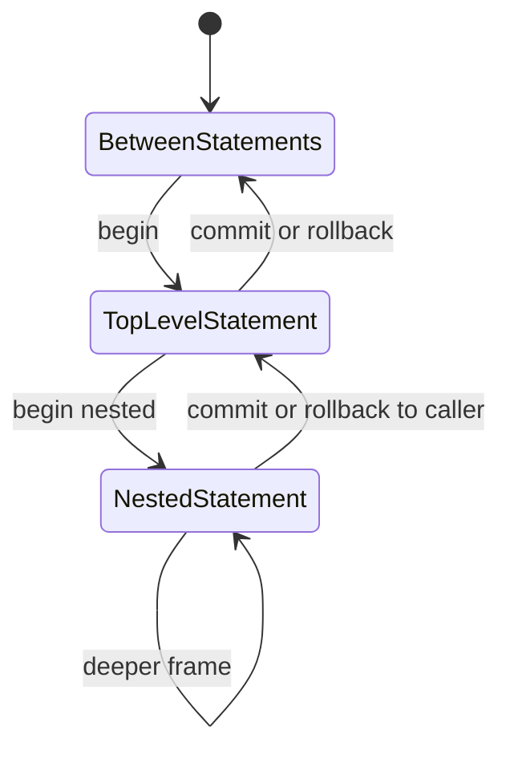

# Parser state machines

The parser keeps session history in one opaque `LexerState`, with pure transitions
in `Language.PHP.Parser.State`. Local validators keep their own domain states.
Recursive grammar, AST constructors and existing context types remain the state
representation where no mutable history is required.

## Session ownership

`Parser` remains `ParsecT` over `State`. Megaparsec's `try` rewinds input without
rewinding that underlying state. `withStatement` and `withSpan` therefore restore
the complete session snapshot on failure. `Lexer.lookAhead` restores it on both
success and failure; its input commitment and errors follow Megaparsec's
`lookAhead`. Stateful token probes must use this wrapper.

A statement frame records its caller's site and original script progress.
Successful exit restores the site and sets progress to the original progress or
top-level entry. In particular, it does not merge progress written by nested
statements. Other successful history effects survive.

Namespace entry checks lateness before mixed forms, then records both policies
before parsing the body. Namespace form is independent of top-level declaration
history because a nested declaration can lock a form. Close-tag consumption
marks script progress, consumes its terminator claim once, and updates the declare
prologue only for a standalone tag. The statement parser owns newline suppression.

The recursive statement-site value retains every caller; the diagram groups
nested frames for display. Rollback restores the whole snapshot, while commit
retains successful trivia and declaration history.

## Inventory coverage

IDs match the inventory at `69cbd21a`. “Retained” means the existing code already
expresses the protocol directly. It does not mean an additional machine was added.

| ID | State representation and owner | Verification |
| --- | --- | --- |
| P01 | Opaque session snapshots and statement entry/commit transitions in State and Lexer. | Script flow lifecycle and rollback cases. |
| P02 | Owned pending trivia and span map; first-span ownership set in Parser; RootVisit in Internal. | Trivia ownership and widened-root cases. |
| P03 | TokenBoundary distinguishes an absent endpoint from recorded token/trivia positions. | Annotation tests and exact behavior comparison. |
| P04 | CodeRegion selects PHP or HTML with its continuation in Statement. | Script mode and mixed-body cases. |
| P05 | CloseTagUse has standalone/terminator states; consumeCloseTag owns reset and content marks. | Close-tag lifecycle and declaration cases. |
| P06 | StatementSite, ScriptProgress and DeclarePosition in State. | Script event sequences and nested frames. |
| P07 | FirstNamespace and independently locked NamespaceForm; atomic enterNamespace. | Script event sequences, mixed and nested namespace cases. |
| P08 | Per-kind modifier tokens and histories with ordered ModifierProblem results in Statement. | Declaration sequences and diagnostic comparison. |
| P09 | HookHistory has no/get/set/both states and rejects duplicate transitions. | Hook sequences in declaration flow. |
| P10 | Retained ClassContext and ParamContext select declaration constraints. | Existing statement and declaration tests. |
| P11 | ArgumentPrefix and accumulated violations in Internal. Unpack errors retain priority. | Call sequences and competing-diagnostic cases. |
| P12 | ParameterHistory owns names, first duplicate and VariadicHistory. | Parameter sequences and competing-diagnostic cases. |
| P13 | Retained AST-derived receiver capabilities. Each postfix step checks the actual receiver. | Nullsafe call/write examples and expression tests. |
| P14 | Retained TernaryMode and recursive grammar. | Expression tests and behavior comparison. |
| P15 | Retained restricted new/instanceof operand grammar and ClassTarget constructors. | Expression tests and behavior comparison. |
| P16 | Retained type constructors, NameKind and ordered grammar alternatives. | Type flow shape/acceptance and qualified-name tests. |
| P17 | Retained clause parsers and AST predicates for switch/match defaults and try tails. | Statement/expression tests and invalid-tail comparison. |
| P18 | Retained committed halt-compiler parser followed by raw payload consumption. | Script tests and halt payload comparison. |
| P19 | Retained distinct line/block/doc comment parsers with explicit terminators. | Literal comment-boundary and trivia cases. |
| P20 | NumericBase selects digit rules, radix and prefix behavior in Lexer. | Expression tests and literal behavior comparison. |
| P21 | Closed interpolation context couples each delimiter to its decoder in Lexer. | Literal and round-trip tests. |
| P22 | HeredocHeader distinguishes interpolation from nowdoc; validated closing indentation has named states. | Literal indentation, label and unterminated cases. |
| P23 | Retained HtmlEntry in Pretty selects opening and closing tag handling. | Mixed HTML round-trip tests. |
| P24 | TextPosition distinguishes line start from inside a line in Pretty. | Heredoc label-escaping cases. |
| S01 | Retained opaque PHPOracle with verified interpreter discovery, optional cached verdict and atomic map insertion. | Fake-process cache/discovery checks and real PHP oracle. |
| S02 | ImportReservation returns collision or the complete new reservation. Rejected groups reserve nothing. | All 781 bounded overlapping import sequences. |
| S03 | CaseOutcome commits rejection, preservation or failure through recordOutcome in the round-trip harness. | Ten CLI scenarios including injected failure controls. |
| S04 | Retained named wizard stage functions, per-process stage index and separate persisted values. | Twenty isolated wizard assertions. |

## Compatibility

The normal parse and print APIs are unchanged. `Language.PHP.Parser.Lexer` is an
exposed low-level module. `LexerState` is now opaque; its constructor and record
fields are removed. Custom parsers should initialize through `initialLexerState`
and use the semantic Lexer operations. Split namespace query/record operations and
the close-tag flag reader are replaced by `enterNamespace` and `consumeCloseTag`.

## Reproduce the checks

Run `bash scripts/check-state-machines.sh` for all ten bounded protocol runners and the session transition comparison.
They test finite cases against the real code; they are not formal proofs. The
round-trip runner's injected failures exercise reporting and are expected controls.

Run `bash scripts/check-state-equivalence.sh` to build both the baseline revision
`1c1586e` and the current library against one deterministic corpus. It compares
acceptance, complete annotated ASTs, printer output and diagnostics exactly. This
is a bounded comparison, not evidence about every PHP input. The separate trivia
regression deliberately changes previously duplicated comments and is checked by
the trivia runner, alongside the characterization corpus. The corpus contains comments but does not
replace the targeted tests for previously duplicated comment positions.

CI also runs the existing test suite across three GHC versions and macOS, and the
real differential oracle against PHP 8.2 through 8.5. The state job attaches its
logs as `state-machine-verification` for review.
